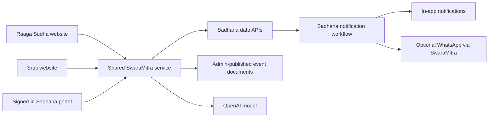

# SwaraMitra and Sadhana — v1 Product and Integration Plan

**Status:** working plan from requirements discussion, 26 November 2026  
**Purpose:** review the product boundaries before implementation. This plan records current decisions; open choices are marked.

## Product shape

- **Sadhana is authoritative** for classes, schedules, venues, enrolments, event registrations, homework, practice and learner identity.
- Admin-published documents provide event-specific details that are not yet structured in Sadhana, such as rehearsal instructions, outfits and event practice guidance.
- Public website visitors receive public information only. Personal class, learner and participant details require sign-in and Sadhana access checks.
- The assistant uses Gemini through a backend service, with a configured primary model and fallback sequence. Model calls never receive database credentials or unrestricted student records.
- Signed-in Sadhana users ask in natural language; SwaraMitra uses the server-verified account and its authorised student/family/class scope. No command keywords are required.
- Practice entries are made in Sadhana. Practice reminders link the learner back to the relevant Sadhana action; the old WhatsApp keyword-led logging flow is not carried forward.

## Source and answer rules

1. Sadhana records win for facts Sadhana owns, including times, venues, enrolments and registrations.
2. The latest **approved/current** admin document wins for event-specific details maintained in documents.
3. If two current approved sources still conflict, do not guess. Flag the conflict for an administrator and tell the user the detail cannot yet be confirmed.
4. Answers should show an appropriate source and its update date. Personal information is returned only after the backend checks the signed-in person's access.
5. Admin documents may be stored in a restricted Drive folder or an admin document library in Sadhana. **Open choice:** decide the upload and approval workflow before implementing document ingestion.

The assistant must fail safely when a source is missing, stale, unreadable or contradictory. No model can guarantee perfect answers; source controls, access checks, review and escalation reduce the risk of confusion.

## Notifications

| Trigger                                   | In-app audience                        | Optional WhatsApp audience                                       |
| ----------------------------------------- | -------------------------------------- | ---------------------------------------------------------------- |
| Class time, venue, change or cancellation | Active learners affected by the change | Same affected learners and authorised guardians who are eligible |
| Homework assigned                         | Learners assigned the homework         | Those learners and eligible authorised guardians                 |
| Homework reviewed                         | Learner whose work was reviewed        | That learner and eligible authorised guardians                   |
| Event change                              | Registered participants                | Participants and eligible authorised guardians                   |
| Scheduled practice reminder               | Learners in the configured class       | Same audience where WhatsApp eligibility and consent allow       |

### Student WhatsApp preference

- Keep a per-student SwaraMitra WhatsApp preference, surfaced to authorised teachers in the master class enrolment section.
- The preference is **on by default**. A teacher can turn it off when the student or guardian declines; an off preference suppresses all SwaraMitra WhatsApp notifications for that student, including scheduled reminders.
- In-app notifications remain active regardless of the WhatsApp preference.
- This student preference is separate from the action-level **“Also send WhatsApp”** checkbox on a class/event/homework form. That action checkbox remains unchecked by default; it controls whether that particular change is sent to WhatsApp.
- Apply this preference consistently across classes and notification types. The default-on value records the academy's service setting; it is **not** permission to message. Send WhatsApp only when the relevant student or guardian has a recorded WhatsApp permission and is otherwise eligible. If permission is missing, skip WhatsApp and retain the in-app notification. The teacher roster records who gave permission, and changes are audited against the student record.
- A family contact may be used for several students. The recipient resolver must respect each student's preference and avoid sending a message about an opted-out student through a guardian number. How to combine preferences when siblings share a guardian number remains an open detail.

### Send flow

1. In a supported class/event/homework form, the sender can choose the action-level WhatsApp checkbox (unchecked by default). In-app notification remains on independently.
2. If WhatsApp is selected, resolve the affected, authorised audience from Sadhana, apply each student's preference and permission, show the unique destination count, and prepare an editable message before saving. Facts and recipient scope remain system-controlled.
3. The sender reviews and confirms the draft, then saves the action. Sadhana persists the change and in-app notification; only after a successful save is the WhatsApp job queued for immediate delivery. A failed save creates no WhatsApp job.
4. A delivery failure never rolls back the saved change or in-app notification.
5. Record truthful statuses (queued, submitted, delivered when supported, failed); use idempotency and bounded retries to prevent duplicates.

Class/event/homework change notices are immediate after a successful save. Practice reminders are scheduled per class. Admins manage their institution; teachers manage only their assigned classes. WhatsApp recipients are guardians plus students who are independently eligible, authorised, and not opted out. Verification alone is not consent.

## Existing website chat API migration

The current Charu service exposes two public chat routes and one health route:

| Current route          | Method | Current request              | Current response                                  |
| ---------------------- | ------ | ---------------------------- | ------------------------------------------------- |
| `/api/chat/raagasudha` | `POST` | `{ "message", "sessionId" }` | `{ "answer", "sessionId", "site": "raagasudha" }` |
| `/api/chat/sruti`      | `POST` | `{ "message", "sessionId" }` | `{ "answer", "sessionId", "site": "sruti" }`      |
| `/api/health`          | `GET`  | —                            | `{ "ok": true }`                                  |

Both website widgets currently use `VITE_CHAT_API_URL`. The replacement should preserve these paths and response shapes where practical, retain site-specific CORS allowlists, and provide a tested endpoint/config change for both websites before the old service is stopped. Website sessions are public and must never receive private learner details.

Sadhana chat will use a separate authenticated route and identity context. WhatsApp delivery will use a backend-to-service integration; no provider secret is exposed in browser code.

## What to learn from Charu; what to replace

| Keep as learning or contract                                                                                                                 | Replace with new SwaraMitra services                                                                                                                                                                                                      |
| -------------------------------------------------------------------------------------------------------------------------------------------- | ----------------------------------------------------------------------------------------------------------------------------------------------------------------------------------------------------------------------------------------- |
| Separate Raaga Sudha and Śruti answer scopes; source-aware answers; clear fallbacks when information is missing.                             | Charu's Gemini client/configuration and old prompts/persona, merged whole-document context, website scraping cache and in-memory conversation state. SwaraMitra uses the newly configured Gemini models with a new warm, concise voice.   |
| Current website chat request/response contract and each site's allowlist, unless a planned API version makes a change worthwhile.            | The bot's Google Sheets/Docs/Calendar clients, credentials, spreadsheets as operational sources, old cron jobs and keyword handlers. Sadhana becomes the academy data source.                                                             |
| Lessons from PDF/DOCX/Sheet extraction and event-specific content; reuse a document only after an admin confirms it is current and approved. | `whatsapp-web.js` session and LocalAuth state, EC2/PM2 runtime, old CDK stack, SSM environment, CloudWatch group and personal-repository deployment workflow. Build isolated SwaraMitra infrastructure under the Raga Sudha organization. |
| Existing Sadhana login/permissions, authoritative records and in-app notification foundation.                                                | No old bot secrets, session state, student logs or contact lists are copied into the new service. Re-resolve people and audiences from Sadhana.                                                                                           |

The old bot remains a read-only reference during the build, then its services and credentials can be retired after the website API cutover. Website widgets may be refreshed to the SwaraMitra look; preserving their API contract does not require keeping the old UI or runtime.

## Repository and deployment proposal

- Keep portal UI, communication settings, access control, source-of-truth APIs and in-app notification triggers in the organization-owned [`raagasudha-academy/sadhana`](https://github.com/raagasudha-academy/sadhana) repository.
- Create a new private organization-owned repository (working name: `swaramitra`) for the shared assistant API, public website compatibility routes, approved-document ingestion and WhatsApp delivery.
- Pause the existing personal-repository bot while the replacement is built. Treat it as a reference; do not carry over its Google Sheets/Docs/Calendar dependencies as sources of truth.
- Keep the old website API available until both site widgets are configured for the replacement and the cutover is verified.

## Environments and resource isolation

SwaraMitra has **two environments**. Local development uses the shared dev environment; production is isolated and is never used for testing.

| Local / dev                                                                                                                  | Production                                                                                                   |
| ---------------------------------------------------------------------------------------------------------------------------- | ------------------------------------------------------------------------------------------------------------ |
| Local UI and service development connect to the shared dev APIs and cloud resources. There is no separate local cloud stack. | Separate production APIs, service runtime, data access, document library, queues, storage, logs and secrets. |
| Synthetic/test records and a dev-only approved-document library.                                                             | Real Sadhana production records and production-approved documents only.                                      |
| Dedicated test WhatsApp sender or tightly allowlisted test recipients; no live student broadcasts.                           | Production sender and recipients, enabled only for approved releases and authorised sends.                   |
| Dev OpenAI credential/configuration, quotas and monitoring.                                                                  | Separate production credential/configuration, budget controls and monitoring.                                |
| Local development, integration checks, test event packs and recipient-preview validation.                                    | No testing with fake recipients, test documents, or test notifications.                                      |

Keep credentials, API base URLs, CORS origins, identity pools, Drive access, model configuration, schedules and notification resources environment-specific. Local/dev must fail closed if production credentials or endpoints are supplied; production must never fall back to dev. Promote reviewed code and configuration templates from dev to production, but do not copy dev data into production or production records into dev. Use the protected production deployment approval already established for Sadhana.

## Build sequence

1. Inventory current Sadhana read APIs, write triggers, guardian/student relationships, notification records and contact/consent fields; inventory the old bot's Google sources and active schedules.
2. Finalize the admin document upload/approval workflow and the recipient eligibility policy, especially consent, student age and guardian access.
3. Build the shared answer service with institution and channel scopes, Sadhana data tools, approved-document retrieval, source labels, freshness and fail-closed conflict handling.
4. Migrate both website chat APIs and widgets; add authenticated Sadhana chat.
5. The teacher roster records the student-level WhatsApp toggle and whether permission was given by the student or their parent/guardian. Server-side preference and permission checks now gate personalized SwaraMitra WhatsApp identity reads. Next, add action-level checkboxes, editable drafts, recipient previews, post-save WhatsApp queue, delivery history and per-class practice reminder settings.
6. Validate with synthetic users and an event test pack; review answers and recipient lists with administrators before sending to real event participants.
7. Switch website configuration and enable the new service. Retire the old service after the new routes and workflows are confirmed.

## Decisions captured

- Public information may be answered on the websites; personal details require Sadhana sign-in and access checks.
- Use Sadhana plus admin-published event documents. Exact document storage/upload location remains open.
- Event WhatsApp audience: event registrants and authorised guardians; student messages require separate eligibility and authorisation.
- Sender may edit a draft, but not system-derived facts or recipient scope.
- Send relevant class/event/homework changes immediately after successful save, only to authorised affected audiences; configure practice reminders per class.
- Student WhatsApp preference is on by default and teacher-editable in the master class enrolment section. Turning it off suppresses SwaraMitra WhatsApp notices for that student while preserving in-app notifications. This default setting is not permission: explicit permission must be recorded before WhatsApp sends; missing permission suppresses WhatsApp while leaving in-app notifications active. Preference and permission changes are audited. Shared-family-number handling remains open before real sends.
- Institution admins manage institution settings; teachers manage assigned classes.
- The v1.7 requirements register's generated-message/no-custom-edit wording is superseded by the confirmed editable-draft decision above. Other confirmed controls remain applicable.
- **SwaraMitra** is the approved name for the new assistant and notification service. “Charu” refers to the legacy bot only.
